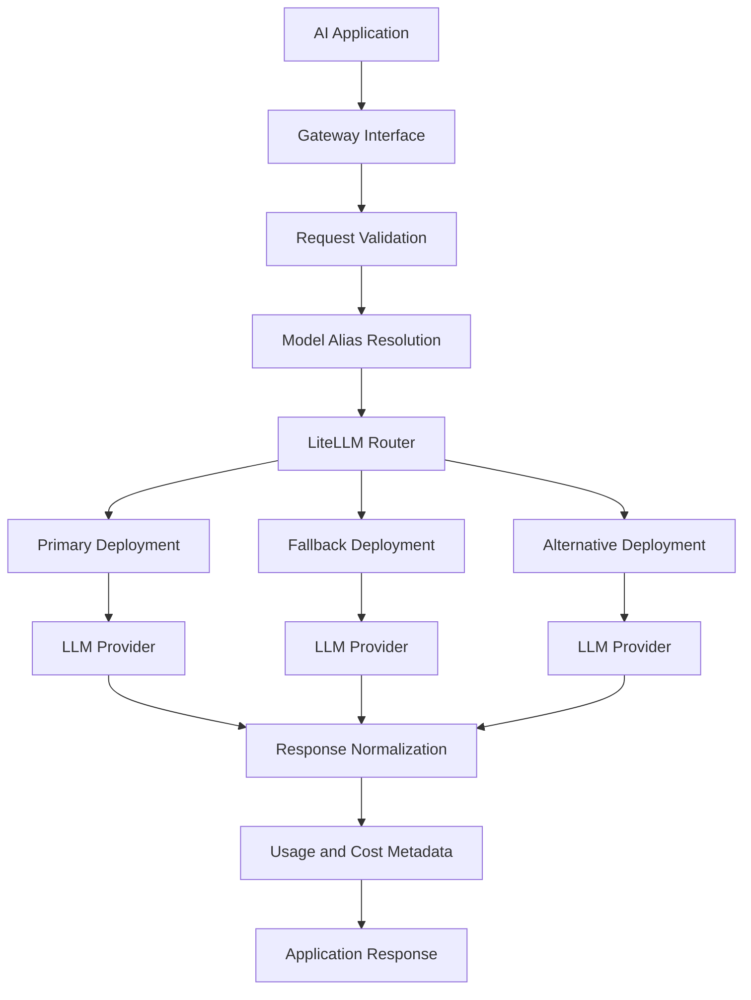

# LLM Gateway — Unified Access to Multiple LLM Providers

A provider-agnostic LLM routing layer built with **Python, LiteLLM, and LangChain** to simplify model integration, improve inference resilience, and provide a foundation for cost-aware AI applications.

[](https://www.python.org/)
[](https://github.com/BerriAI/litellm)
[](https://www.langchain.com/)

## Overview

Applications that integrate directly with multiple Large Language Model (LLM) providers often accumulate provider-specific SDKs, authentication logic, request formats, error handling, and billing calculations. Switching models or recovering from a provider outage can require application-level changes.

**LLM Gateway explores a unified abstraction layer between AI applications and model providers.**

It uses LiteLLM to route requests to configured models through a consistent interface. Applications can select a logical model alias while the gateway configuration determines the underlying provider and model.

The current implementation is a notebook-based prototype demonstrating routing patterns and integrations. The long-term objective is to evolve these patterns into a production-ready service with a stable API, centralized configuration, authentication, observability, and operational controls.

## Key Capabilities

### 1. Unified multi-provider access

Integrate with OpenAI and Groq through a common completion interface.

- Standardize model invocation using a shared request format.
- Keep provider-specific model identifiers and credentials in configuration.
- Reduce provider coupling in application code.
- Make model experimentation and provider changes easier.

### 2. Automatic fallback routing

Configure a primary model and one or more fallback models.

When a supported provider request fails, LiteLLM's router can attempt an alternate configured deployment according to its routing and retry configuration.

**Example:** An application requests a response using `primary`. If the primary deployment encounters a retryable failure, the router can attempt the configured fallback deployment.

Fallback behavior must be validated against provider errors, retry limits, latency budgets, and model compatibility before production use.

### 3. Model aliases and task-oriented routing

Expose logical model names such as:

- `fast-cheap` — a model selected for lower-cost or latency-sensitive tasks.
- `smart-coding` — a model selected for coding-oriented workloads.
- `balanced` — a model selected as a general-purpose option.

Aliases decouple application code from physical provider model identifiers. Model selection should be based on measured latency, quality, availability, and cost rather than the alias name alone.

### 4. Load balancing across deployments

Configure multiple deployments under a shared model alias and experiment with LiteLLM routing strategies, including `simple-shuffle` and `least-busy`.

This provides a foundation for distributing inference traffic across compatible deployments.

Production routing should additionally consider provider quotas, deployment health, concurrency limits, rate limits, and model capabilities.

### 5. Token usage and cost estimation

Inspect completion usage metadata, including prompt and completion token counts, and estimate request costs using LiteLLM's `completion_cost` utility.

These measurements help compare model choices and understand the cost implications of different inference workloads.

Cost estimates should be reconciled with actual provider billing and should account for model-specific pricing, cached tokens, and other applicable charges.

### 6. Response caching

Experiment with LiteLLM's local caching support to reuse eligible responses for repeated requests.

Caching can reduce redundant provider calls, lower latency, and potentially reduce inference costs.

A production implementation should define cache-key semantics, expiration, invalidation, concurrency behavior, and tenant isolation. It should not reuse personalized or sensitive responses across users.

### 7. LangChain integration

Integrate LiteLLM with LangChain using `ChatLiteLLM`, `ChatPromptTemplate`, and `StrOutputParser`.

This demonstrates how the same model abstraction can be incorporated into LangChain Expression Language (LCEL) pipelines without tightly coupling prompt orchestration to one provider.

## Architecture

The intended logical architecture is:



The diagram represents the target service architecture. The notebook demonstrates the LiteLLM routing, provider invocation, usage/cost inspection, caching, and LangChain integration components; the complete gateway API and operational components are future implementation work.

### Request lifecycle

1. **Receive:** An application submits a prompt and logical model identifier.
2. **Validate:** The service validates the request schema, supported parameters, and configured limits.
3. **Resolve:** The requested alias maps to one or more configured deployments.
4. **Route:** The router selects a deployment according to the configured strategy.
5. **Recover:** Eligible failures trigger configured retries or fallback attempts.
6. **Normalize:** The provider response is converted to the gateway's documented response format.
7. **Measure:** Usage, latency, selected deployment, and estimated cost are captured where available.
8. **Return:** The response and applicable metadata are returned to the caller.

Steps 1–3 and 5–8 describe the intended production service lifecycle, not a claim that all of these service components are already implemented.

## Technology Stack

| Technology | Purpose |
|---|---|
| Python | Core implementation language |
| LiteLLM | Unified model invocation, routing, fallback, caching, and cost utilities |
| OpenAI API | Primary provider integration in the examples |
| Groq API | Alternative provider integration in the examples |
| LangChain | Prompt templates and composable LLM pipelines |
| python-dotenv | Local environment-variable loading |
| Jupyter Notebook | Interactive development and experimentation |

## Repository Structure

```text
LLMGateway/
├── README.md
└── llm_gateway.ipynb
```

The repository currently centers on the exploratory notebook. A production-oriented evolution could introduce the following structure:

```text
LLMGateway/
├── app/
│   ├── api/
│   │   ├── routes.py
│   │   └── schemas.py
│   ├── core/
│   │   ├── config.py
│   │   └── logging.py
│   ├── gateway/
│   │   ├── router.py
│   │   ├── providers.py
│   │   └── usage.py
│   └── main.py
├── tests/
│   ├── unit/
│   ├── integration/
│   └── resilience/
├── examples/
├── requirements.txt
├── .env.example
├── .gitignore
├── Dockerfile
└── README.md
```

The second tree is a proposed structure, not the current repository layout.

## Getting Started

### Prerequisites

- Python 3.12 or a compatible Python version supported by the selected dependencies.
- Jupyter Notebook or JupyterLab.
- An OpenAI API key for the OpenAI examples.
- A Groq API key for the Groq examples.

### 1. Clone the repository

```bash
git clone https://github.com/vasudha21/LLMGateway.git
cd LLMGateway
git checkout feature-initial-setup
```

### 2. Create an isolated environment

```bash
python3 -m venv .venv
source .venv/bin/activate
```

On Windows:

```powershell
.venv\Scripts\activate
```

### 3. Install dependencies

```bash
python -m pip install --upgrade pip
python -m pip install jupyter litellm python-dotenv requests langchain-litellm
```

For reproducible installations, pin and test compatible dependency versions in a dedicated requirements file. The notebook's exploratory dependency installation should not be treated as a production dependency-management strategy.

### 4. Configure credentials

Create a local `.env` file:

```dotenv
OPENAI_API_KEY=your_openai_api_key
GROQ_API_KEY=your_groq_api_key
```

Never commit `.env` files, API keys, or other credentials to version control. In deployed environments, use a managed secrets service or an equivalent secure secret-injection mechanism.

### 5. Launch the notebook

```bash
jupyter notebook llm_gateway.ipynb
```

Run the cells in order, beginning with the provider setup and basic completion examples.

**Note:** The notebook contains experiments that install or upgrade dependencies at runtime. Run it in a disposable virtual environment rather than an environment shared with unrelated projects.

## Example: Unified Model Invocation

The following standalone example illustrates the shared completion interface used by the project.

```python
import os
from dotenv import load_dotenv
from litellm import completion

load_dotenv()

response = completion(
    model="gpt-4o-mini",
    messages=[
        {
            "role": "user",
            "content": "Explain LLM gateways in one sentence."
        }
    ],
    timeout=30,
)

print(response.choices[0].message.content)
```

## Example: Primary and Fallback Models

The following illustrates the routing pattern explored in the notebook.

```python
from litellm import Router

router = Router(
    model_list=[
        {
            "model_name": "primary",
            "litellm_params": {
                "model": "gpt-4o-mini",
                "api_key": "os.environ/OPENAI_API_KEY",
            },
        },
        {
            "model_name": "fallback",
            "litellm_params": {
                "model": "groq/openai/gpt-oss-20b",
                "api_key": "os.environ/GROQ_API_KEY",
            },
        },
    ],
    fallbacks=[
        {"primary": ["fallback"]}
    ],
)

response = router.completion(
    model="primary",
    messages=[
        {
            "role": "user",
            "content": "Explain retrieval-augmented generation."
        }
    ],
)

print(response.choices[0].message.content)
print("Reported model:", response.model)
```

Provider model identifiers and support can change. Verify the selected model names, API access, request parameters, and fallback compatibility before running the example.

## Production Readiness

A reliable production gateway requires more than a unified completion interface. The following controls are recommended before exposing the service to real users.

| Area | Production requirement |
|---|---|
| API design | Versioned API, request/response schemas, consistent error contracts |
| Authentication | Caller authentication, authorization, and API-key rotation |
| Traffic management | Per-client rate limits, concurrency limits, quotas, and request-size limits |
| Reliability | Explicit timeouts, bounded retries, exponential backoff, circuit breakers, and fallback policies |
| Cost governance | Per-request usage records, budgets, spend limits, and billing reconciliation |
| Observability | Structured logs, request IDs, latency/error metrics, tracing, and alerting |
| Security | TLS, secret management, input validation, sensitive-data handling, and access controls |
| Caching | Safe cache keys, TTL, invalidation, and isolation between users or tenants |
| Testing | Unit, integration, load, provider-failure, and regression tests |
| Deployment | Containerization, CI/CD, health checks, controlled rollouts, and rollback procedures |

These items are a production-readiness checklist, not features that the current notebook is claimed to implement.

### Reliability considerations

Fallbacks should be limited to failures that are appropriate to retry. Authentication errors, invalid requests, unsupported parameters, and quota exhaustion may require different handling from transient timeouts or provider-side server errors.

Retries should be bounded by a total request deadline to avoid multiplying latency and cost. Where providers offer different model capabilities, fallback deployments must also be tested for response quality, context-window limits, structured output, and tool-calling compatibility.

### Security and privacy

- Keep provider credentials outside source code.
- Authenticate and authorize callers before routing requests.
- Avoid logging raw prompts, completions, or secrets by default.
- Apply explicit retention policies to request metadata and any cached data.
- Enforce tenant isolation and access controls.
- Review provider data-processing and retention policies before sending sensitive information.

### Observability and cost controls

For each request, a production service should aim to capture:

- Request ID and timestamp.
- Requested model alias and selected deployment.
- Provider outcome and normalized error category.
- End-to-end latency and provider latency.
- Input and output token usage when reported.
- Estimated cost and cache-hit status where applicable.

Useful operational metrics include request throughput, error rate, p50/p95/p99 latency, fallback frequency, timeout rate, and cost per model or tenant. Metrics should use bounded-cardinality labels to prevent observability costs from growing with individual request IDs.

## Testing Strategy

Before production deployment, validate the following scenarios:

1. Successful requests to each configured provider.
2. Fallback behavior when the primary deployment is unavailable.
3. Timeout and retry behavior under slow provider responses.
4. Handling of authentication, invalid-model, rate-limit, and server errors.
5. Correct token-usage and cost calculations.
6. Cache hits, expiration, invalidation, and isolation.
7. Concurrent requests and provider quota enforcement.
8. Response compatibility across primary and fallback models.
9. Secret redaction and protection of sensitive request data.
10. Dependency reproducibility and regression testing after upgrades.

## Current Scope and Roadmap

### Demonstrated in the notebook

- [x] OpenAI and Groq completion examples.
- [x] LiteLLM router configuration.
- [x] Primary-to-fallback routing examples.
- [x] Logical model aliases and task-oriented selection.
- [x] Experiments with shuffle and least-busy routing strategies.
- [x] Token usage and estimated-cost inspection.
- [x] Local response caching.
- [x] LangChain prompt-template and output-parser integration.

### Recommended next steps

- [ ] Extract reusable gateway logic from the notebook into Python modules.
- [ ] Build a versioned REST API with validated request and response schemas.
- [ ] Add caller authentication, authorization, rate limiting, and quotas.
- [ ] Externalize model and routing configuration.
- [ ] Add bounded retries, circuit breakers, deadlines, and provider health management.
- [ ] Introduce structured logging, metrics, distributed tracing, and alerts.
- [ ] Add automated unit, integration, and resilience tests.
- [ ] Pin dependencies and establish automated vulnerability scanning.
- [ ] Containerize the service and implement CI/CD.
- [ ] Define deployment, rollback, incident-response, and cost-governance procedures.

## Contributing

Contributions are welcome.

1. Open an issue describing the proposed change.
2. Create a focused feature branch.
3. Add tests for new routing or provider behavior.
4. Document configuration changes and operational implications.
5. Submit a pull request with a clear description of the changes.

Provider-specific integrations should be designed to preserve the gateway's unified interface and avoid leaking provider implementation details into application-facing contracts.
